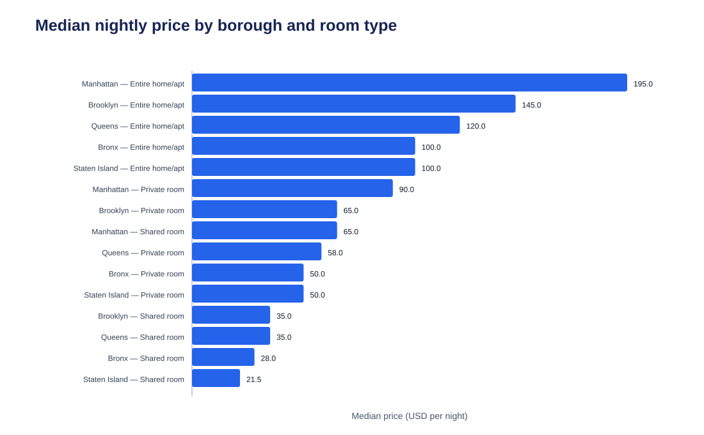
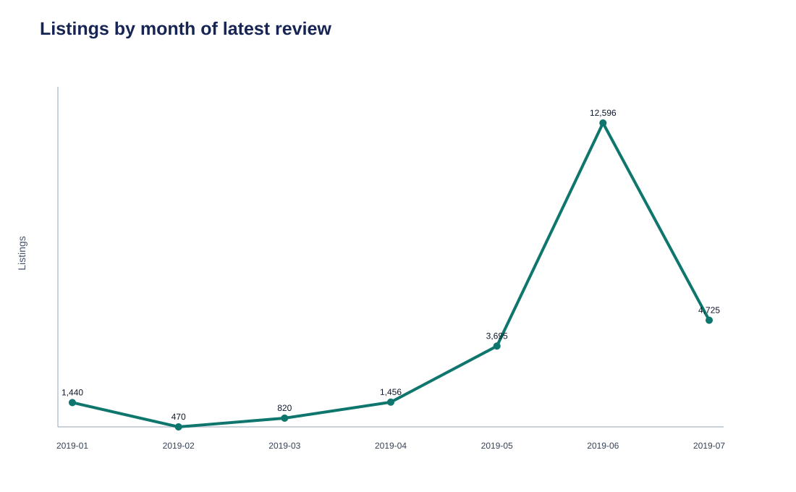

# NYC Airbnb Market Analysis

Portfolio project examining the 2019 New York City Airbnb listing market using a reproducible Python and SQL workflow.

**Skills demonstrated:** SQL (CTEs, window functions, percentiles); Python (pandas, statsmodels); data-quality testing; dashboarding.

## Project overview

This project combines three listing-level source files covering prices and locations, descriptions and room types, and hosts and last-review dates. It cleans and validates the joined listings table, loads it into PostgreSQL (with a DuckDB fallback), answers business questions in SQL, estimates an interpretable price model, and presents the results in a Streamlit dashboard.

## Business questions

1. How do listing counts and nightly-price distributions differ by borough and room type?
2. Which borough, neighborhood, and room-type combinations have the highest and lowest median nightly price, subject to a minimum listing-count threshold?
3. How do neighborhoods rank within each borough by median price and listing count?
4. What does the timing of the latest review look like, and what share of listings have recent, stale, or missing reviews?
5. How concentrated are listings among the most frequently occurring host names?
6. Are simple description signals (for example, references to private space, views, transit, coziness, or space) associated with price after accounting for room type and borough?
7. What associations does an OLS model of log nightly price show for room type, borough, and selected text signals?

## Data

The analysis uses three local 2019 NYC listing-level files:

- prices and combined borough/neighborhood labels;
- descriptions and room types;
- host names and last-review dates.

Raw source files are not committed. See [data/README.md](data/README.md) for the required filenames and placement. The data is descriptive and from 2019; it does not contain coordinates, booking/occupancy information, listing size, amenities, or a unique host identifier. A last-review date represents review recency only—it is not a measure of occupancy. Host-name counts are therefore only an approximation of host concentration.

## Methods

1. Profile the raw files, verify the listing key, and document join coverage.
2. Clean prices, geography labels, room types, dates, host names, and text features while retaining quality flags.
3. Run automated data-quality tests on the cleaned listing table.
4. Load the table into PostgreSQL and reproduce the core descriptive results with commented SQL.
5. Cross-check selected SQL aggregates against pandas, fit an OLS model for log price, and assess residual diagnostics.
6. Produce labeled figures and an interactive dashboard using the processed data.

## Key findings

- The cleaned analytical dataset contains **25,202** valid listings. The mean nightly price is **$141.82**, while the median is **$105.00**, confirming a right-skewed distribution.
- Manhattan has the highest borough median nightly price (**$149**), compared with **$95** in Brooklyn, **$70** in Queens, **$71** in Staten Island, and **$65** in the Bronx. With at least 30 listings per group, Manhattan Tribeca entire homes/apartments have the highest median (**$350**); Brooklyn Bedford-Stuyvesant shared rooms have the lowest (**$35**).
- **68.73%** of listings have a latest review in June or July 2019. This is review recency—not occupancy—and the top 10 host names account for **5.88%** of listings, an approximate measure because names are not unique host IDs.
- In the descriptive log-price model (25,192 listings), room type, borough, and simple description signals explain **53.0%** of log-price variation. Relative to entire homes/apartments, private rooms show an estimated **53.6% lower** price association and shared rooms **71.3% lower**, conditional on the included covariates; these are associations, not causal effects.

## Figures





The source code generates all figures from the processed table. The residual plot in `reports/figures/` is included as a model diagnostic.

## Dashboard

The local Streamlit dashboard supplies filters for borough, room type, and nightly price, plus views for price distribution, borough comparison, neighborhood ranking, latest-review recency, and regression coefficients. Run it with `streamlit run dashboard/app.py` after cleaning and analysis.

## Repository structure

```text
nyc-airbnb-market-analysis/
├── data/                 # data instructions, raw (ignored), and generated processed files
├── sql/                  # schema, database-load notes, and commented analytical SQL
├── src/                  # ingestion, profiling, cleaning, validation, database load, modeling
├── tests/                # pytest data-quality and cross-check tests
├── notebooks/            # exploratory notebook
├── dashboard/            # Streamlit app
├── reports/              # profile, summary, figures, dashboard screenshots
└── docs/                 # decisions and cleaning-log record
```

## Reproduce

From the repository root:

```bash
python3 -m venv .venv
source .venv/bin/activate
pip install -r requirements.txt
cp .env.example .env
# Place the three raw files in data/raw/ as described in data/README.md.
python src/profile.py
python src/clean.py
python src/validate.py
pytest
docker compose up -d db
python src/load_db.py
python src/analysis.py
streamlit run dashboard/app.py
```

For a local PostgreSQL installation, create a database matching `DATABASE_URL` in `.env`, then run `python src/load_db.py`. If PostgreSQL or Docker is unavailable, follow the documented DuckDB fallback in [docs/decisions.md](docs/decisions.md).

## Limitations

- The data is a 2019 cross-section and may not represent the current market.
- It is listing-level data with no coordinates, occupancy, booking, revenue, or availability measures.
- The latest-review field is a review-recency measure, not occupancy.
- `host_name` is not a unique host ID; host-concentration statistics based on it are approximate.
- The regression is descriptive, not causal, and omits important price drivers such as size, amenities, and precise location.

## Next steps

Potential extensions include a licensed dataset with geographic coordinates after verifying listing-ID overlap, a model with amenities and unit size, and time-series data that can distinguish reviews from bookings.
